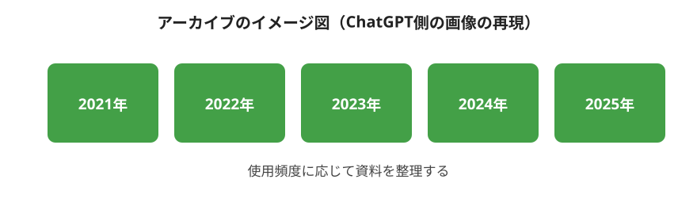

# 071｜アーカイブ

> 出典：ChatGPT 会話「メルクマール解説」の最新単語（52番目）の解説全文。取り出し時に省略した部分はありません。
> 図について：ChatGPT側には「緑のフォルダが2021年〜2025年と並ぶ画像（キャプション：使用頻度に応じて資料を整理する）」と、「アーカイブ／バックアップ／削除を切り替える概念図」がありました。ここではその内容を再現した図と文章で入れています（元の画像ファイル自体ではありません）。
> 確認問題について：ChatGPT側では、選択肢を押すとその場で「正解：X」と解説1文が表示される形式でした。ここに入れた正解と解説は、その実際に表示された原文です。

品詞：名詞・動詞的表現｜分野：IT・情報管理・歴史・仕事
意味：資料や記録、データなどを、後から参照・利用できるように保存すること。また、その保存された資料や記録の集まり。

先輩、仕事で使用した昨年度の資料は、今年度の業務では頻繁に使わないかもしれません。
しかし、過去の処理方法を確認したり、今年度の数値と比較したりする際には必要になりますよね。
そこで、普段使用する資料とは分けて、後から取り出せるように保存しておく。
このような保存の仕組みや、保存された記録を「アーカイブ」といいます。

## 🅰 A｜要点

- 基本的な意味：記録や資料を保存し、後から利用できるようにすること。
- もう一つの意味：保存された記録や資料の集まり。
- 中心イメージ：現在は使わなくても、将来のために保管しておく。
- ニュアンス：長期保存・記録・蓄積・再利用。
- 代表表現：アーカイブに残す、アーカイブ配信、デジタルアーカイブ。
- 活用場面：メール、動画、チャット、業務資料、歴史的文書。
- 注意点：削除やバックアップとは目的が異なる。

## 🅱 B｜詳しい解説

### ① アーカイブの三つの意味

- 記録を保存すること
  現在使用していない資料などを、後から参照できるように保管する。
  例：昨年度の業務資料をアーカイブする。
- 保存された資料の集まり
  過去の記録や文書などを体系的に蓄積したもの。
  例：歴史的な新聞記事のアーカイブ。
- 過去の配信や映像の記録
  ライブ配信などを録画し、終了後も視聴できるようにしたもの。
  例：講演会のアーカイブ配信。

三つに共通するのは、「過去の情報を失わず、後から利用できるようにすること」です。

### ② 言葉の由来

アーカイブの語源は、古代ギリシャ語の「アルケイオン（arkheion）」にさかのぼります。
これは、役人の公邸や官庁など、公的な記録が保管される場所を意味していました。
そこから、公文書の保管場所や保存された記録そのものを指す言葉になり、現在ではデジタルデータの保存にも広く使われています。

### ③ アーカイブと削除の違い

先輩、メールやチャットを整理するとき、アーカイブと削除を混同してはいけません。
アーカイブは、情報を残したまま整理することです。
削除は、情報を取り除くことです。
例えば、メールをアーカイブすると、通常は受信トレイから表示されなくなりますが、メールそのものは残ります。
必要になったときには検索などで見つけられます。

### ④ アーカイブとバックアップの違い

この二つも混同しやすい言葉です。

| 項目 | アーカイブ | バックアップ |
|---|---|---|
| 主な目的 | 記録の保存 | データの消失対策 |
| 利用場面 | 過去の情報の参照 | 故障や誤削除からの復旧 |
| 主な対象 | 過去の資料や記録 | 現在使用しているデータなど |
| 保存期間 | 比較的長期 | 運用方法による |
| 具体例 | 過去10年分の決算資料 | Excelファイルの予備コピー |

アーカイブは、過去の情報を後から利用するためのものです。
バックアップは、万が一データが失われたときに復旧するためのものです。
両方の役割を兼ねる保存方法もありますが、アーカイブしただけでデータ消失への対策が十分になるとは限りません。

## 🅲 C｜イメージ理解

### 会社の書類棚に例えて理解する

上段には、現在の業務で使用する資料が並んでいます。
下段には、過去の資料が年度別に整理されています。
普段は下段の資料を使わなくても、必要になれば取り出すことができます。
これがアーカイブの基本的なイメージです。

### アーカイブ・削除・バックアップを比較する

- **アーカイブ**：作業場所（移動後は空）→ 保管場所。「保管する」。現在の作業場所から資料を移し、過去の記録として保存する。後から過去の資料を参照できる。
- **バックアップ**：作業場所（資料はそのまま）→ 予備の保存先。「複製する」。現在の資料をそのまま残し、予備の保存先にコピーを保存する。資料が失われた場合に復旧できる。
- **削除**：作業場所（移動後は空）→ ごみ箱など。「取り除く」。不要な資料を取り除く。完全に削除されると、通常は参照できなくなる。

それぞれの代表的な運用を示した概念図です。

## 🅳 D｜具体例

### 例文①：経理業務
「昨年度の月次決算資料を年度別にアーカイブした。」
→ 過去の資料を、必要に応じて参照できるように整理しています。

### 例文②：動画配信
「仕事でライブ配信を見られなかったので、アーカイブで視聴した。」
→ ライブ配信終了後に保存された映像を見ています。

### 例文③：メール
「対応が完了したメールをアーカイブして、受信トレイを整理した。」
→ メールを削除せず、普段の表示から外しています。

### 例文④：歴史
「明治時代の新聞記事がデジタルアーカイブとして公開されている。」
→ 歴史的な資料を電子化し、後世の人も閲覧できるようにしています。

### 例文⑤：ChatGPT
「学習が完了したチャットをアーカイブした。」
→ 会話を削除せず、通常のチャット一覧から整理しています。

### 例文⑥：企業活動
「過去の会議資料や議事録をアーカイブ化する。」
→ 組織の意思決定や活動の記録を蓄積しています。

### 例文⑦：写真
「旅行で撮影した写真を、年代や場所ごとにアーカイブした。」
→ 思い出の記録を、後から見返しやすいように保存しています。

### 例文⑧：学習
「これまで調べた日本語の単語をアーカイブし、復習に活用する。」
→ 学習した内容を蓄積し、将来も利用できるようにしています。

## 🔍 類義語・似た言葉との違い

### ① アーカイブと保存
- アーカイブ：後から参照できるように記録を保管すること。
- 保存：情報や物を失わないように残しておくこと全般。
- Excelファイルを上書き保存することは保存です。
- 過去のExcelファイルを年度別に整理して保管することは、アーカイブの一例です。

### ② アーカイブとバックアップ
- アーカイブ：過去の記録を残し、参照するためのもの。
- バックアップ：データが失われた場合に備えるためのもの。
- アーカイブは記録の保存、バックアップは復旧に重点があります。

### ③ アーカイブとデータベース
- アーカイブ：記録や資料の保存、または保存された記録の集まり。
- データベース：情報を検索・管理・更新しやすいように体系的に整理したもの。
- 現在の顧客情報を管理する仕組みはデータベースです。
- 過去の取引記録を長期保存する仕組みはアーカイブです。
- データベースを利用してアーカイブを構築することもできます。

### ④ アーカイブとログ
- アーカイブ：保存された記録や資料の集まり。
- ログ：操作や出来事などを記録したもの。
- システムへのログイン履歴や操作履歴はログです。
- そのログを長期保存することはアーカイブです。

### ⑤ アーカイブとストレージ
- アーカイブ：記録を保存する仕組みや保存された記録。
- ストレージ：データを保存するための装置や領域。
- SSDやクラウドストレージは、データを保存する場所です。
- そこに過去の資料を整理して保管することがアーカイブです。

### ⑥ アーカイブと圧縮
- アーカイブ：記録の保存。また、IT分野では複数のファイルを一つにまとめることも指す。
- 圧縮：データの容量を小さくすること。
- 例えば、複数のファイルを一つのZIPファイルにまとめることは、アーカイブと圧縮を兼ねる場合があります。
- ただし、アーカイブには必ずしも圧縮が伴うわけではありません。

### ⑦ アーカイブとキャッシュ
- アーカイブ：将来の参照などを目的とした記録の保存。
- キャッシュ：処理や表示を高速化するための一時的なデータ保存。
- キャッシュは必要に応じて消去・再生成されるものですが、アーカイブは記録を残すこと自体に価値があります。

## 💡 仕事で役立つアーカイブの考え方

先輩、資料は単に保存しておけばよいというものではありません。
必要になったときに見つけられなければ、保存した情報を十分に活用できませんよね。

### フォルダ構成の具体例
- 経理資料
  - 2026年度（使用中）
    - 銀行明細
    - 入金一覧
    - 月次決算
    - 部門別資料
  - アーカイブ
    - 2025年度
    - 2024年度
    - 2023年度
    - 2022年度
- このように現在使用する資料と過去の資料を分けることで、日常業務で必要なファイルを見つけやすくなります。
- ただし、会社の資料には保存期間やアクセス権限などの決まりがある場合があります。個人の判断だけで移動や削除をしないことも重要です。

### アーカイブのメリット・デメリット

| メリット | デメリット |
|---|---|
| 作業場所を整理できる | 保存容量が必要になる |
| 過去の情報を参照できる | 分類や管理に手間がかかる |
| 知識や経験を蓄積できる | 整理が不十分だと検索しにくい |
| 業務の引き継ぎに役立つ | 古いファイル形式が使えなくなる場合がある |
| 過去と現在を比較できる | 機密情報の管理が必要になる |

## 💡 アーカイブと単語帳の関係

先輩、これまで学習した単語をGitHub Pagesなどで単語帳として保存することも、デジタルアーカイブの一種と考えられます。

- 情報の収集：単語の意味・解説・具体例を学ぶ
- 情報の整理：単語・カテゴリ・解説形式ごとに分類する
- アーカイブ化：文章・画像・問題などを保存する
- 検索・再利用：必要な単語を探して復習する
- 知識の蓄積：過去の学習内容を新しい学習につなげる

単にチャットの内容を残すだけでなく、検索や理解確認、復習ができるように整理することで、保存した情報の活用価値が高まります。

## 📖 関連する日本語

| 言葉 | 意味 |
|---|---|
| アーカイブ | 記録の保存や保存された資料の集まり |
| アーカイビング | 記録をアーカイブする作業 |
| アーカイビスト | 記録資料の保存・管理などを担う専門職 |
| 公文書館 | 公的な記録や文書を保存する施設 |
| 蓄積（ちくせき） | 物事を少しずつ積み重ねること |
| 編纂（へんさん） | 資料を集めて整理し、書物などにまとめること |
| 目録（もくろく） | 資料や物品などを一覧にしたもの |
| 索引（さくいん） | 必要な情報を探すための手掛かり |
| ナレッジ | 活用できる知識や知見 |
| リポジトリ | データや資料、プログラムなどの保管場所 |
| デジタル化 | 情報をデジタル形式に変換すること |
| メタデータ | 作成日や作成者など、データに関する情報 |

## 📝 理解確認｜3問（答えはクリックで開く）

**Q1. アーカイブの主な目的は？**
- A. 不要な情報を完全に消去すること
- B. 記録を保存し、後から参照できるようにすること
- C. データの処理速度を上げること

正解と解説を見る

正解：B
アーカイブの主な目的は、記録や資料を保存し、将来も利用できるようにすることです。

**Q2. アーカイブとバックアップの違いは？**
- A. アーカイブは記録の保存、バックアップは消失時の復旧に重点がある
- B. アーカイブは必ずデータを削除する
- C. バックアップは動画にしか使えない

正解と解説を見る

正解：A
両者には重なる部分もありますが、主な目的が異なります。

**Q3. アーカイブの活用例として適切なのは？**
- A. 過去の資料をすべて完全に削除する
- B. ファイル名を変更するだけで保存しない
- C. 過去の決算資料を年度別に整理し、必要なときに参照する

正解と解説を見る

正解：C
過去の資料を整理して保管し、再利用できるようにすることは代表的なアーカイブの活用例です。

> Pages版でもChatGPTと同じ形式を再現しています。選択肢を押すと、その場で合否（正解です！／正解を確認しましょう）と「正解：X」、解説が表示され、下部に「正解数：n / 3問」と「もう一度」（リセット）が出ます。

## ⏱️ 30秒復習

| 項目 | 内容 |
|---|---|
| 品詞 | 名詞 |
| 基本的な意味 | 記録や資料を保存すること |
| もう一つの意味 | 保存された記録の集まり |
| 中心イメージ | 将来のために保管する |
| ニュアンス | 長期保存・蓄積・再利用 |
| 代表表現 | アーカイブ配信 |
| バックアップとの違い | 記録の保存とデータの復旧 |
| 削除との違い | 情報を残すか取り除くか |
| 活用場面 | 仕事・動画・メール・学習 |
| 重要な考え方 | 後から利用できるように整理する |

## 🧠 一文記憶

「今すぐには使わなくても、将来必要になったときに取り出せるよう、過去の記録や資料を保存しておくこと。それがアーカイブ。」

## これまで学んだ言葉との総合的な理解

先輩、読書や学習を通じて知識を蓄積する場面を考えてみましょう。
まず、本の「あらまし」を把握する。
重要な内容を自分なりに「咀嚼」し、理解を深める。
情報量の「さじ加減」を考えながら、学習内容を整理する。
整理した知識を「アーカイブ」し、必要になったときに取り出す。
繰り返し復習することで、知識を定着させ、実際の判断や行動に生かす「リテラシー」を身につける。
アーカイブとは、過去の情報を残すだけでなく、過去の知識や経験を未来に生かすための仕組みでもあるんです。

---
[← 目次に戻る](../README.md) ｜ 前：051 さもありなん
